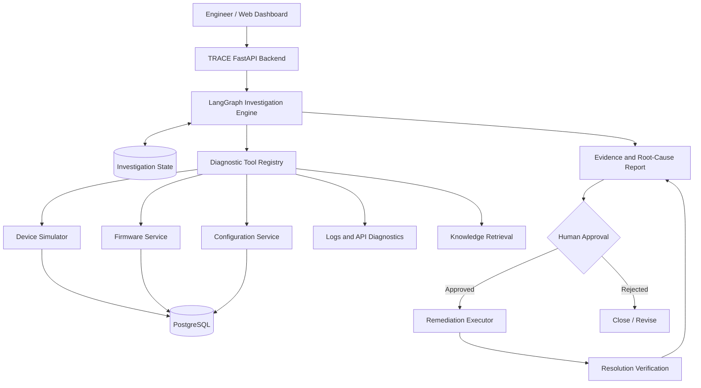

# TRACE — System Architecture

**Technical Root-cause Analysis & Contextual Engineering**

**Status:** Phase 0 — Architecture & Foundation  
**Version:** 0.1  
**Project Type:** Agentic AI / Enterprise Troubleshooting Platform

---

## 1. Overview

TRACE is an AI-powered engineering investigation platform designed to diagnose technical failures across interconnected enterprise systems.

It uses an LLM-driven investigation workflow to select diagnostic tools, gather evidence, evaluate competing hypotheses, identify probable root causes, and recommend corrective actions.

Unlike conventional conversational assistants, TRACE interacts with a live simulated environment rather than relying exclusively on user-provided information.

The initial implementation focuses on industrial device and enterprise software workflows, including device connectivity, firmware compatibility, API failures, configuration errors, and service dependencies.

## High-Level Design

[View TRACE Master Architecture](docs/high-level-design.md)

## 2. Problem Statement

Diagnosing technical failures often requires engineers to manually inspect multiple independent systems:

- Device status and connectivity
- Firmware versions and compatibility requirements
- Application and API logs
- Configuration settings
- Database and service health
- Historical incidents and technical documentation

Information is fragmented, and engineers must determine which diagnostic checks to perform, correlate the results, and identify the underlying cause.

**TRACE aims to reduce this investigation effort through evidence-driven AI orchestration while keeping consequential remediation actions under human control.**

## 3. System Goals

### Functional Goals

1. Accept an incident description and identify the affected system.
2. Generate and maintain possible root-cause hypotheses.
3. Dynamically select and execute relevant diagnostic tools.
4. Collect structured evidence from multiple services.
5. Update hypotheses based on observed results.
6. Produce a root-cause report with supporting evidence and uncertainty.
7. Recommend remediation steps.
8. Require explicit approval before modifying system state.
9. Execute approved remediation and verify the outcome.
10. Record investigations for auditing and evaluation.

### Non-functional Goals

- Modular and extensible architecture
- Replaceable LLM providers
- Reproducible failure scenarios
- Secure, validated tool execution
- Observable investigation workflows
- Persistent investigation state
- Containerized local deployment
- Automated testing and measurable evaluation

## 4. High-Level Architecture

### Architecture Layers

| Layer | Responsibility | Planned Technology |
|---|---|---|
| Presentation | Incident dashboard, investigation timeline, approval controls | Angular, TypeScript |
| API | Incident and investigation endpoints | Python, FastAPI |
| Agent | Stateful diagnostic workflow and tool selection | LangGraph, LLM API |
| Tools | Validated access to diagnostic capabilities | Python, REST APIs |
| Simulation | Device, firmware, configuration and failure scenarios | FastAPI services |
| Persistence | Incidents, evidence, configuration and investigation state | PostgreSQL |
| Knowledge | Technical documentation and historical incident retrieval | RAG, embeddings |
| Evaluation | Controlled scenarios, metrics and regression tests | Pytest, Python |
| Infrastructure | Local service orchestration | Docker Compose |

## 5. Core Components

### 5.1 TRACE API

The FastAPI backend provides the interface between users, the investigation engine, and the simulated environment.

Initial endpoints:

- `POST /incidents` — Create an incident.
- `GET /incidents/{incident_id}` — Retrieve incident details.
- `POST /investigations` — Start an investigation.
- `GET /investigations/{investigation_id}` — Retrieve investigation status and results.
- `POST /investigations/{investigation_id}/approval` — Approve or reject a proposed remediation.

Authentication and authorization will be added before enabling remote deployments or access to consequential actions.

### 5.2 Investigation Engine

LangGraph will orchestrate a stateful investigation process.

Proposed workflow:

1. Parse incident details.
2. Identify initial hypotheses.
3. Select the next diagnostic tool.
4. Execute the tool and validate its result.
5. Store evidence.
6. Reevaluate hypotheses.
7. Repeat until sufficient evidence is available or an investigation limit is reached.
8. Generate a diagnosis and recommended action.

The workflow must also support an **inconclusive** result when evidence is insufficient.

Initial safeguards:

- Maximum investigation steps
- Tool execution timeouts
- Structured tool inputs and outputs
- Retry limits
- Explicit handling of unavailable services
- No unrestricted system or shell execution

### 5.3 Diagnostic Tool Registry

The tool registry exposes capabilities that the agent may invoke.

Initial read-only tools:

| Tool | Purpose |
|---|---|
| `get_device_status` | Check device availability and state |
| `get_firmware_version` | Retrieve installed firmware |
| `check_firmware_compatibility` | Validate firmware compatibility |
| `get_device_configuration` | Retrieve configuration values |
| `check_service_health` | Check dependent service availability |
| `get_api_logs` | Retrieve relevant API diagnostics |
| `check_connectivity` | Check simulated connectivity |

Every tool should have a defined input schema, output schema, error handling, timeout and permission level.

The LLM may request tool execution, but the application controls whether and how the tool is executed.

### 5.4 Simulated Enterprise Environment

The first version of TRACE will operate against a controlled environment consisting of:

**Device Simulator:** Represents devices, operating states, installed firmware and connectivity.

**Firmware Service:** Maintains firmware packages, versions, compatibility rules and update eligibility.

**Configuration Service:** Stores device settings and supports controlled configuration changes.

**Log Service:** Exposes operational and application events generated by the environment.

**Failure Injection Engine:** Introduces reproducible faults into the simulated environment.

The environment must maintain its own state independently of the LLM.

### 5.5 Evidence and Hypothesis Management

An investigation should preserve:

- Hypothesis identifier and description
- Current status: untested, supported, contradicted or inconclusive
- Diagnostic observations
- Tool and service source
- Timestamp
- Supporting and contradicting evidence
- Final root-cause conclusion

The agent must not treat an unverified hypothesis as a confirmed fact.

A numerical confidence score may be introduced later, but it should not be presented as a calibrated probability without evaluation.

### 5.6 Knowledge Retrieval

The knowledge layer will support retrieval from:

- Public or synthetic device documentation
- Firmware compatibility specifications
- API documentation
- Troubleshooting procedures
- Historical simulated incidents

Retrieved information provides context, not automatic proof of the current incident's cause.

### 5.7 Remediation and Verification

TRACE will separate read-only investigation tools from state-changing remediation tools.

Remediation sequence:

1. Generate a proposed action.
2. Validate parameters and permissions.
3. Present the action, risk and supporting evidence.
4. Pause for explicit human approval.
5. Execute the approved action.
6. Recheck the affected system.
7. Record whether verification succeeded.

Initial remediation will be limited to safe, reversible changes in the simulated environment.

## 6. Data Models

### Incident

| Field | Description |
|---|---|
| `incident_id` | Unique incident identifier |
| `device_id` | Affected device, if applicable |
| `title` | Short description |
| `description` | Observed symptoms |
| `severity` | Incident priority |
| `status` | Open, investigating, resolved or inconclusive |
| `created_at` | Creation timestamp |

### Investigation

| Field | Description |
|---|---|
| `investigation_id` | Unique investigation identifier |
| `incident_id` | Associated incident |
| `status` | Current workflow state |
| `hypotheses` | Candidate root causes |
| `evidence` | Collected diagnostic observations |
| `tool_calls` | Executed diagnostic operations |
| `root_cause` | Final or probable diagnosis |
| `recommended_action` | Proposed remediation |
| `verification_status` | Result of post-action checks |

### Failure Scenario

| Field | Description |
|---|---|
| `scenario_id` | Unique scenario identifier |
| `failure_type` | Category of injected fault |
| `affected_component` | Service or device affected |
| `injection_parameters` | Fault configuration |
| `ground_truth` | Actual injected root cause |
| `expected_diagnostics` | Observations that should reveal the fault |
| `expected_remediation` | Acceptable corrective action |

**Important:** Ground-truth fields belong to the simulation and evaluation system. They must never be exposed to the investigating agent.

## 7. Initial Failure Scenarios

The MVP will begin with five scenarios:

| ID | Failure | Expected Diagnostic Area |
|---|---|---|
| INC-001 | Device offline | Device status |
| INC-002 | Firmware incompatibility | Version and compatibility rules |
| INC-003 | Invalid configuration | Configuration service |
| INC-004 | API returns an empty result | API logs and dependencies |
| INC-005 | Authentication failure | Service authentication diagnostics |

Additional scenarios will include network timeouts, database latency, unavailable dependencies and combined failures.

## 8. Evaluation Strategy

TRACE will be evaluated against reproducible incidents with known ground truth.

Initial metrics:

- **Root-cause accuracy:** Correct diagnoses divided by evaluated incidents.
- **Remediation correctness:** Recommended actions matching acceptable fixes.
- **Investigation latency:** Time required to produce a conclusion.
- **Tool efficiency:** Number of diagnostic calls per investigation.
- **Evidence quality:** Whether conclusions are supported by recorded observations.
- **False diagnosis rate:** Incorrect conclusions presented as diagnoses.
- **Verification success:** Whether approved actions restore the expected system state.

A basic non-agentic or fixed-checklist baseline will be compared against TRACE where practical.

Evaluation results must come from actual executions, not illustrative numbers.

## 9. Technology Stack

| Category | Initial Choice |
|---|---|
| Primary language | Python |
| Backend | FastAPI |
| Agent orchestration | LangGraph |
| LLM | Configurable provider |
| Database | PostgreSQL |
| Frontend | Angular + TypeScript |
| Testing | Pytest |
| Containerization | Docker + Docker Compose |
| Source control | Git + GitHub |

Planned extensions include RAG, agent tracing, MCP-compatible integrations and cloud deployment. These are not prerequisites for the first working MVP.

## 10. Implementation Phases

### Phase 0 — Foundation
- Architecture documentation
- Repository initialization
- Docker Compose foundation
- Initial schemas and failure scenarios

### Phase 1 — Simulated Environment
- Device, firmware and configuration services
- Persistent state
- Structured logs
- Failure injection
- Integration tests

### Phase 2 — First Working Agent
- LLM integration
- LangGraph workflow
- Diagnostic tools
- Multi-step investigation
- Initial diagnosis report

### Phase 3 — Evidence-Driven Investigation
- Hypothesis tracking
- Evidence persistence
- Tool selection controls
- Inconclusive diagnosis handling
- Investigation history

### Phase 4 — Knowledge and Remediation
- Documentation retrieval
- Historical incident search
- Human approval
- Controlled remediation
- Resolution verification

### Phase 5 — Evaluation and Deployment
- Expanded incident dataset
- Automated evaluation
- Observability
- Angular dashboard
- Containerized deployment
- Demonstration and technical documentation

## 11. Security and Operational Constraints

- Store API keys and credentials in environment variables or a secrets manager.
- Never commit secrets to GitHub.
- Validate all tool inputs before execution.
- Use least-privilege access for diagnostic integrations.
- Require human approval for state-changing actions.
- Record investigation and remediation activity.
- Treat retrieved documents, logs and external tool outputs as untrusted data.
- Limit agent execution time, cost and tool usage.
- Do not use confidential employer source code, internal documents, credentials or customer data.

## 12. Definition of Done — MVP

The initial MVP is complete when:

1. The simulated environment starts successfully using Docker Compose.
2. At least five distinct failure scenarios can be injected and reproduced.
3. TRACE can retrieve live diagnostic evidence through tools.
4. The agent can perform a multi-step investigation.
5. TRACE produces a structured root-cause report with evidence.
6. The system can return an inconclusive result instead of inventing a diagnosis.
7. Investigation results can be inspected and tested.
8. Automated tests cover the core environment and agent workflow.

Human-approved remediation, RAG, dashboards and cloud deployment will extend the MVP into the portfolio-ready version.

---
## Architecture Decisions

| Decision | Choice | Rationale |
|---|---|---|
| Backend | FastAPI | Python-native APIs and LLM integration |
| Agent orchestration | LangGraph | Stateful, multi-step investigation workflows |
| Database | PostgreSQL | Persistent incidents, evidence and system state |
| Frontend | Angular | Structured dashboard and approval workflows |
| Deployment | Docker Compose | Reproducible local development |
| LLM | Provider-agnostic | Enables model comparison and replacement |
| Initial environment | Simulated services | Reproducible failures with known ground truth |

These decisions may be revisited based on implementation and evaluation results.

## MVP Scope

### Included
- Device, firmware and configuration simulators
- Five reproducible failure scenarios
- FastAPI backend
- LangGraph investigation workflow
- Diagnostic tool calling
- Hypothesis and evidence tracking
- Structured root-cause reports
- Basic automated evaluation

### Deferred
- Multi-agent architecture
- MCP integration
- Cloud deployment
- Production authentication
- Advanced Angular dashboard
- Historical incident RAG
- Human-approved remediation
- Multi-model benchmarking

Deferred features will be considered after the MVP is functional and tested.

**Architecture principle:** TRACE must investigate observable system behavior, not simply infer the answer from an incident description.